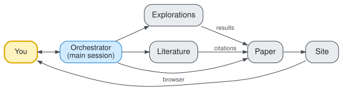
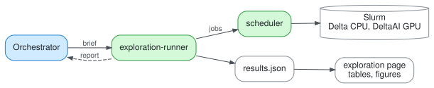
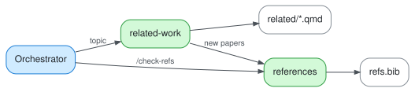
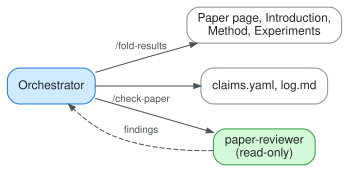

# How this project works {#sec-workflow .unnumbered}

The main Claude session is the **orchestrator**: it talks to you, plans, writes briefs,
and hands self-contained work to sub-agents, which run in the background and report
back. Agent definitions are in `.claude/agents/`, commands in `.claude/commands/`.
The diagrams are Graphviz sources in `web/diagrams/*.dot`, drawn to SVG by
`tools/render_diagrams.sh`.

## Overview {#sec-workflow-overview}

{#fig-workflow-overview}

| Module | What it is for | Started by |
|---|---|---|
| Explorations | trying things: code, cluster jobs, every number | `/new-exploration`, `/schedule` |
| Literature | reading papers, keeping `refs.bib` correct | `/add-related`, `/check-refs` |
| Paper | the argument: Paper page, Introduction, Method, Experiments | `/fold-results`, `/check-paper`, `/export-latex` |
| Site | showing all of it in your browser | automatic after every edit |

Git: every agent stages only; you commit and push.

## Explorations {#sec-workflow-explorations}

{#fig-workflow-explorations}

The orchestrator checks the runner's numbers against `results.json` before telling you.

## Literature {#sec-workflow-literature}

{#fig-workflow-literature}

## Paper {#sec-workflow-paper}

{#fig-workflow-paper}

## Site {#sec-workflow-site}

{#fig-workflow-site}

## Roles {#sec-workflow-roles}

| Agent / command | Does | Writes |
|---|---|---|
| Orchestrator (main session) | plans, writes briefs, starts sub-agents, folds results into the paper | `index.qmd`, `intro.qmd`, `method/`, `experiments/`, `claims.yaml`, `log.md`, `ideas.qmd`, registry entries |
| exploration-runner (`/new-exploration`) | runs one exploration end to end: code, jobs, evaluation, write-up | its `explorations/exp-NNN/` folder, code in the ESPnet worktree |
| scheduler (`/schedule`) | submits and tracks Slurm jobs from the registry, requeues retryable failures | job state in `registry.yaml`, `status.qmd`, `.scheduler/` |
| related-work (`/add-related`) | finds and reads papers on a topic | `related/*.qmd`, entries via references |
| references (`/check-refs`) | adds and verifies BibTeX under the citation rules | `refs.bib` |
| paper-reviewer (`/check-paper`) | checks claims, numbers, links and the LaTeX build | nothing (reports only) |
| `/fold-results`, `/export-latex` | orchestrator procedures: fold an exploration into the paper; export for Overleaf | paper pages; LaTeX output |
